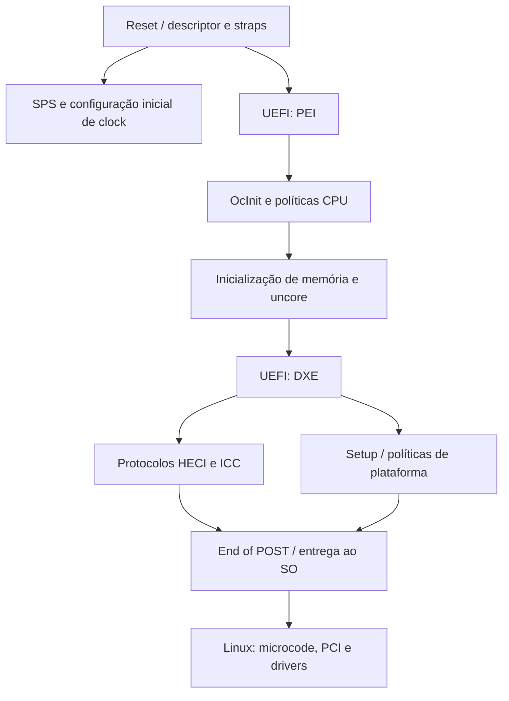

# Etapa 03 — Boot, módulos UEFI, IntelSetup e fluxo de inicialização

> Fase: levantamento de requisitos e estudos. Registro derivado da [pesquisa consolidada](../xeon-e5-2680v4-h9s-pesquisa-bclk-icc.md), de 26/11/2026. Não representa novos testes em hardware.

Objetivo: mapear componentes e rotinas que carregam políticas, opções de setup e informações de clock.

## 7. IntelSetup / IFR / NVRAM

UEFIExtract e IFRExtractor-RS foram usados para extrair `Platform.bin`, `Setup.bin`, `IccPlatform.bin`, `IccOverClocking.bin`. O formset IntelRCSetup tem GUID `EC87D643-EBA4-4BB5-A1E5-3F3E36B20DA9`; VarStore 1 `IntelSetup` tamanho 0x17EC (6124 bytes). VarStore 2 `AmiSetupSupportedFeatures` tamanho 4, mesmo GUID. VarStore 3 `SystemAccess`, GUID `E770BB69-BCB4-4D04-9E97-23FF9456FEAC`, tamanho 1.

### Campos relevantes (offsets relativos ao payload IntelSetup, não offsets SPI)

| Campo | Offset | Tamanho | Observações |
|---|---:|---:|---|
| OC visibility QID 13FC | 0x163D | 1 | zero nas cópias NVRAM |
| Overclocking Feature QID E3F | 0x163F | 1 | default 0 |
| Extreme Edition QID D8F | 0x13FC | 1 | default 1; distinto do QID 13FC |
| Overclocking Lock QID D90 | 0x13FD | 1 | opções 0/1; efeito real no MSR não provado |
| Filter PLL | 0x163E | 1 | GPIO8, default 0 |
| Adjust PLL | 0x17C1 | 1 | ajuste para combinação de BCLK elevado, default 0 |
| PLL Trim | 0x17C2 | 4 | magnitude 0–15, não MHz |
| PLL Trim Prefix | 0x17C6 | 1 | sinal +/− |
| TJMax offset | 0x17C7 | 1 | não alterar neste projeto |
| CLR minimum ratio | 0x17C8 | 1 | ajuste de cache |
| AVX2 offset | 0x17D7 | 1 | ajuste de ratio AVX |
| SfrTrim | 0x17D8 | 1 | workaround HSX |
| CPU core ratios | 0x16E7 em diante | 24 WORDs | 14º em 0x1701 |
| CPU Flex Ratio Override | 0xA4 | 1 | escondido; não-turbo |
| CPU Core Ratio | 0xA3 | 1 | default 23; não-turbo |
| FIVR faults | 0x16B1 | 1 | default 1: manter proteções OVP/OCP |
| FIVR efficiency | 0x16B2 | 1 | default 1; não alvo atual |
| ICC override clock enables | 0x12EB | 1 | default 0 |
| ICC/OC watchdog | 0x12EC | 1 | default 0 |
| ICC unused clocks | 0x12ED | 1 | default 1 |
| ICC Profile | 0x12EF | 1 | default 0, dependente do OEM |
| ICC Profile editable | 0x12F0 | 1 | flag dinâmica |
| DMI frequency | 0x12F9 | 2 | default 0; unidade desconhecida |
| PCI frequency | 0x12FB | 2 | default 0; unidade desconhecida |
| DMI spread | 0x12FE | 1 | 0,01% por passo conforme IFR |
| PCI spread | 0x12FF | 1 | 0,01% por passo conforme IFR |
| DMI/PEG ratio | 0x1301 | 1 | 5:5, 5:4, 5:3, 5:2 |
| DMI visible / PCI visible | 0x1304 / 0x1305 | 1 cada | flags dinâmicas |
| DMI editable / PCI editable | 0x1307 / 0x1308 | 1 cada | flags dinâmicas |
| ICC Locks after EOP | 0x130F | 1 | default 0; não alterar cegamente |
| ICC editable | 0x1311 | 1 | flag dinâmica |
| SSC override | 0x132B | 1 | 1 override / 2 auto |
| SSC0–SSC7 mode | 0x132C–0x1333 | 1 cada | down/center/disable/no change/auto |
| External SSC CK420 | 0xF5 | 1 | somente spread spectrum externo, não prova chip presente |
| ME FW Image Re-Flash QID D12 | 0x1334 | 1 | 0 auto, 1 disabled, 2 enabled; não é SKU |
| HMRFPO lock / enable | 0x12D0 / 0x12D1 | 1 cada | defaults 1/0 |
| End of POST / Global reset lock | 0x12D2 / 0x12D3 | 1 cada | defaults 1/1 |
| HECI1/2, IDER, KT | 0x12D4–0x12D7 | 1 cada | auto=2 |
| ME State | 0x171C | 1 | valor 1 nos registros observados |

Os menus DMI/PCI aparecem com frequência de exemplo 100,00 MHz, downspread 0,50%, limites `uninitialized`. Mudanças são descritas como aplicadas após salvar e resetar. Os campos são condicionados por flags e callbacks. Não está provado se a frequência é codificada em MHz, centésimos ou outra representação, nem se esses campos são o CPU BCLK. Não gravar `101` ou `10100` neles por dedução.

### NVRAM encontrada no dump

Dois volumes de 256 KiB, FFSv2, arquivo NVAR GUID `CEF5B9A3-476D-497F-9FDC-E98143E0422C`. Estados de arquivo no dump:

| Região | Base do arquivo | Estado | Último registro IntelSetup | Payload absoluto |
|---|---:|---|---|---:|
| 0 | 0x800048 | F0, invertido 0F, bit alto 08: marked for update | 586 | 0x828E38 |
| 1 | 0x840048 | F8, invertido 07, bit alto 04: data valid | 352 | 0x85F4A1 |

Região 0: OC_ENABLE=1, OC_LOCK=1, EXTREME=1, primeiros dez ratios 33, restantes 0. Região 1: OC_ENABLE=0, OC_LOCK=0, EXTREME=1, ratios zero. Ambas: OC_VISIBLE=0; ICC_LOCK, ICC_PROFILE, DMI/PCI_CLOCK, flags ICC editáveis =0; HECI1/2/IDER/KT=2; EXTERNAL_SSC=0. Região 1 provavelmente ativa, mas não verificada por leitura de variável no firmware.

`IntelSetup` não apareceu em efivars runtime; variável pode ser acessível apenas em boot services. Não confundir histórico de registro NVAR com configuração efetiva da CPU. A presença dos menus e valores não prova que a placa implemente overclock.

## 8. Engenharia reversa do código UEFI

### 8.1 PpmInitialize

- Rotina original em torno de 0x2318 copia 24 WORDs de ratios da política.
- Lê `MSR 0x35`, `0x1AD`, `0x1AE`, `0x1AF`, `0x1AC`.
- 0x2410 lê PLATFORM_INFO, 0x241B lê MSR194, 0x243E extrai OC bins.
- 0x2445/0x244C testa bit 28 de PLATFORM_INFO e desvia se zero; 0x2452/0x2454 testa OC bins e desvia se zero. Ambos são zero na CPU testada.
- Caminho de escrita em torno de 0x2770/0x27A3 manipula MSR194 e política de ratios.

Os guards são de software, mas o teste de mailbox rejeitado demonstra uma restrição adicional. CpuMpDxe solicita ratio pelo MSR199 e usa limites de turbo; não foi localizado um mecanismo comprovado de desbloqueio nele.

### 8.2 OcInit original (endereços relativos ao código original)

- Entrada 0x4A84, buffer local 0x1894, tabela de straps 100/125/166/250 em 0x4AAD.
- Busca IntelSetup com tamanho 0x17EC em 0x4B2A; OC_ENABLE=0 causa saída.
- 0x5724 consulta OC Mailbox command 1; extrai ratio max e bits de capacidades.
- Guard de ratio em 0x4B8C/0x4B90 impede avanço se `RatioOcSupported=0`.
- 0x4B96/0x4B9B tenta ler MSR61E. No Linux essa leitura falhou; não sabemos o comportamento no PEI.
- CPUID 306f/406f diferencia rotinas de ajuste de PLL.
- 0x647E usa dados de HECI/PCI e sincroniza strap; não é prova de que configura a frequência física independentemente.

Trecho do diff, com endereço PEI mapeado:

```asm
ffdc4b84: call 0xffdc5724
ffdc4b89: add esp,0x10
ffdc4b8c: cmp BYTE PTR [ebp-0x17],0x0
ffdc4b90: je 0xffdc4ea5
ffdc4b96: mov ecx,0x61e
ffdc4b9b: rdmsr
```

A condição pode ser modificada em software, mas fazê-lo isoladamente pode levar à execução de RDMSR não suportado e impedir POST. **Não é uma imagem pronta para gravação.** É necessário compreender os guards de capacidade e a rotina de falha antes de desenvolver uma alternativa.

### 8.3 Transportes e ajustes privados

OcInit possui transportes de mailbox em 0x5E61 e polling em 0x602D: transporte 2 usa MSR150, transporte 1 usa janela MMIO via helper/PEI protocol, offsets 0x5DA0 (data) e 0x5DA4 (interface), bit 31 busy. O formato de resposta do caminho MMIO precisa ser revisado (possível cópia da interface em vez de data).

Encoder de comando 0x11 (0x5A3F–0x5BAB): ratio bits 7:0, alvo de tensão bits 19:8, modo bit 20, offset bits 31:21. Domínio 2 também interage com MSR620. Isso não representa BCLK em MHz.

PCU mailbox em 0x677A: usa bus de MSR300, janelas PCI f8040/f8044 (interface/data). Fluxos de PLL observados:

- HSX 306f: SfrTrim usa sequência de operações privadas (não demonstradas em execução).
- BDW 406f: PLLTrim assinado (−15…+15), não incremento em MHz.
- Adjust PLL: condiciona execução a strap existente 125/166 MHz, não estabelece por si só um novo strap.
- CLR min/max: rotinas de cache; não confundí-las com CPU BCLK.

Mapa PCI uncore e valores históricos (somente observação, não instruções de escrita):

| Dispositivo | Identificação | Registradores observados |
|---|---|---|
| ff:1f.0 | PCU 8086:6f88 | 40.L=0x90, 44.L=0 |
| ff:1e.1 | PCU 8086:6f99 | 8C.L=0x00c20002, 90.L=0 |
| ff:10.7 | Ubox 8086:6f1f | 5C=0x20, 60=0x230, 64=0, 68=1, 6C=0 |

Em `OcInit` 0x647E, offsets b0000/b0040/b0048/b0060/b0064/b0068/b006c correspondem a HECI1 em ECAM, não a um PLL independente. A rotina confronta strap observado com MSR61E e tem handshake privado. Não enviar `0x60000001` ao PCI 4C sem semântica validada.

## Fluxo de boot: modelo de dependências



Diagrama conceitual: não é uma captura de ordem exata do firmware. PEI/DXE e SPS podem interagir em momentos diferentes; a ordem real de cada módulo e de EOP ainda precisa ser confirmada por dependências e trace de boot.

## Catálogo de módulos (não são classes Java/C++)

| Módulo | Fase ou função provável | Evidência / limite |
|---|---|---|
| Platform / Setup | Forms IFR e configuração | VarStores e menus extraídos |
| PlatformCpuPolicy | Política CPU | binário comparado; layout completo pendente |
| CpuPei / CpuMpPei | inicialização CPU em PEI | extraídos; fluxo completo não reconstruído |
| CpuMpDxe | CPU multiprocessada DXE | acessos a MSR CE/1AD/199 observados |
| PpmInitialize | política de energia e ratios | guards e escrita identificados |
| OcInit | inicialização OC em PEI | consulta capacidades, strap e PLL |
| UncoreInitPeim | inicialização uncore | extraído; sem prova de ajuste BCLK |
| PlatformEarlyInit | inicialização inicial de plataforma | extraído; grafo de chamadas pendente |
| SpsPei / SpsDxe | inicialização SPS e visibilidade HECI | operações FD2 observadas |
| HeciInitDxe | protocolo de comunicação HECI | associação de função e FD2 observada |
| IccPlatform | integração ICC | gate de tipo de firmware e mensagens |
| IccOverClocking | biblioteca/protocolo ICC | transporte e construtores localizados |
| IioInit / PchSmbusDxe / PlatformType | IIO/SMBus/plataforma | referências a protocolo SMBus, não prova de PLL |

## Distinção entre espaços de endereço

| Tipo | Exemplo | Significado |
|---|---|---|
| Question ID IFR | 0x13FC | identificador de pergunta |
| VarOffset | 0x163D | posição no payload IntelSetup |
| Offset SPI | 0x85F4A1 | posição absoluta de registro NVAR |
| Endereço de instrução PEI | 0xFFDC4B90 | endereço exibido pelo disassembler |
| MSR | 0x61E | índice de registrador CPU |
| GUID | EC87D643-EBA4-4BB5-A1E5-3F3E36B20DA9 | identidade de formset / variável no contexto indicado |

Não converter VMA em offset de arquivo sem consultar a tabela PE/COFF. Para o NVAR, não confundir o estado do arquivo com a prova de que um registro é ativo. A tabela de offsets anterior registra os campos encontrados, não autoriza a edição direta.

## Próxima etapa do ramo PEI

Reconstruir as dependências DEPEX, tipos de PPI/protocolos e chamadas que populam a política CPU e ICC. Identificar condições de erro e de saída antes de considerar qualquer patch. A execução do RDMSR61E após o guard continua um bloqueio. Não há boot modificado validado.

**Saída:** mapa de opções e caminhos de inicialização, sem mecanismo de OC demonstrado. Próximo: [HECI e MMIO](04-heci-pci-mmio.md).
