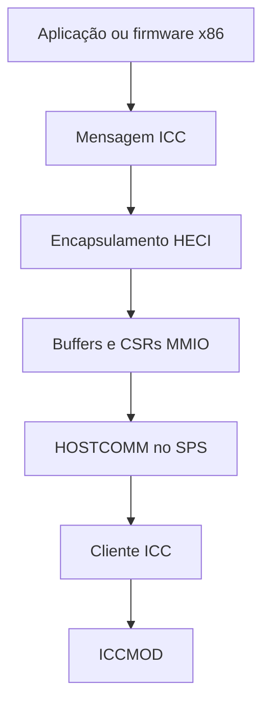

# Etapa 04 — HECI, PCI, MMIO e protocolo de comunicação

> Fase: levantamento de requisitos e estudos. Registro derivado da [pesquisa consolidada](../xeon-e5-2680v4-h9s-pesquisa-bclk-icc.md), de 26/11/2026. Não representa novos testes em hardware.

Objetivo: reconstruir o caminho de comunicação entre software x86 e SPS, distinguindo enumeração PCI de entrega efetiva de mensagens.

## 9. HECI / MEI: tentativas em runtime

### 9.1 Descoberta e exposição PCI

Inicialmente HECI1/2 não apareciam em lspci. DSDT/SSDT continham dispositivos HECI, HEC2, IDER, MEKT e SpsNm, mas tabelas ACPI genéricas não comprovavam interface ativa.

RCBA obtida em PCI 00:1f.0 F0.L = 0xfed1c001; base 0xFED1C000. FD2 em 0xFED1F428, inicial 0x1F. A análise de SpsPei/SpsDxe/HeciInitDxe associou bits 1–4 a HECI1/2, IDER, KT. Em teste anterior, FD2 passou a 0x1D (limpeza do bit HECI1). O dispositivo surgiu no barramento com `8086:8d3a`, rev05, subsystem 8086:7270. O rescan PCI enumerou o dispositivo; BAR0 foi realocado de f831a000 para b4000000. Isso foi alteração volátil já realizada, não alteração do dump SPI.

### 9.2 Driver experimental

`mei_me` padrão recusou o dispositivo com `Device doesn't have valid ME Interface`. HFS1 PCI 40.L=`0x000f0392` contém bits 19:16=f, condição que faz o driver reconhecer SPS no caminho `MEI_ME_PCH8_SPS_4_CFG`.

Foi compilado módulo experimental a partir do kernel 7.0.0, em `~/backup-bios/mei-driver/mei-experimental`, alterando apenas a associação `MEI_LPT_W, MEI_ME_PCH8_SPS_4_CFG` para `MEI_LPT_W, MEI_ME_PCH8_CFG`. Módulo `mei-me.ko` de aproximadamente 1,3 MB, vermagic compatível. Carregamento de módulo sem assinatura contaminou (taint) o kernel. O bypass de reconhecimento não resolveu o protocolo:

```text
mei mei0: waiting for mei start failed
mei mei0: HBM haven't started
mei mei0: link layer initialization failed.
mei_me 0000:00:16.0: init hw failure.
mei_me 0000:00:16.0: initialization failed.
```

Nenhum `/dev/mei0`, nenhum driver vinculado. HBM HOST_START_REQ=1/response=0x81 (referência de protocolo Linux, não resposta recebida do SPS). Não há prova de que o problema seja apenas IRQ. Não repetir a mesma modificação de driver.

### 9.3 Último estado MMIO observado

PCI COMMAND=0x0002 (Mem+; BusMaster-). BAR0=0xB4000000–0xB400000F, 16 bytes. IRQ pin A roteado a 16, MSI desabilitado, D0, grupo IOMMU 53. HFS1=0x000f0392; HFS2/PCI48 variou (último 0x90406006, outros 0x90408006/0x90402006/0x9040c006). PCI4C=0x1300ffff, 60/64/68/6C=0 em observação.

| MMIO | Papel |
|---|---|
| BAR+0x0 | buffer de escrita do host |
| BAR+0x4 | host CSR |
| BAR+0x8 | buffer de leitura do ME/SPS |
| BAR+0xC | ME CSR |

Ambos CSRs retornaram `0x80020209`: profundidade 128 DWORDs, read/write pointers=2, ready=1, reset=0. Isso mostra buffers aparentemente vazios/prontos no instante observado, não prova entrega ou processamento de mensagens. A leitura do buffer de dados pode consumir informação; não confundir com leitura de CSR.

HECI connectionless/fixed-address é hipótese para contornar a dependência de enumeração HBM. Nenhuma mensagem ICC foi efetivamente transmitida/testada. Antes de desenvolver transporte experimental, confirmar cliente e protocolo, impedir disputa com driver e verificar existência de recuperação local. Se for restaurar o software normal, usar módulo padrão do kernel; não alterar FD2 enquanto o PCI estiver enumerado. O estado posterior não foi verificado.

## 10. Protocolo ICC no firmware UEFI

### 10.1 IccPlatform

Função 0x96C distingue modos via HFS1 PCI b0040: nibble 19:16=f leva a retorno 1; outros casos podem retornar 2. Chamadores 0x430 e 0xAA8 exigem 2 para disponibilizar determinada interface. No SPS original o valor observado é compatível com retorno 1. Não implica que **todo** ICC do SPS esteja desabilitado.

Função 0x9A8 localiza protocolo HECI (`CFB33810-6E87-4284-B203-A66ABE07F6E8`), testa modo 0 e status low nibble zero. Constrói comando 0x03, versão 0x00030000, header 20 bytes, payload 12 bytes (dois argumentos de 32 bits e constante 1). Chamada por interface +0x10. Não foi identificada a finalidade exata; não tratar como GET de frequência.

### 10.2 IccOverClocking

PE32 x86-64, base 0x10000000, `.text` VMA 0x10000280, `.rdata` 0x10009420, `.data` 0x100098e0. Função 0x100003C0 usa protocolo HECI via ponteiro global 0x1000A5A0; verifica modo retornado pela função +0x40 e chama slot 0. Argumentos compatíveis com HeciSendwAck: mensagem, tamanho de envio, ponteiro de tamanho de resposta, host 0x00, destino ME 0x08. O endereço e o fluxo estão identificados; entrega ao SPS Grantley não foi provada.

| Rotina | Papel inferido |
|---|---|
| 0x10007500 | wrapper de transporte |
| 0x10007560 | chamada padrão de biblioteca |
| 0x100078A0 | construtor de header |
| 0x10007970 | seleciona command 0x06 |
| 0x100079A0 | interpreta estrutura de resposta |
| 0x10008700 | construtor parcial de header |
| 0x10008770 | preparação/dispatch de mensagem |
| 0x1000889F, 0x10008A3E, 0x10008BD5, 0x10008D84, 0x10008F6C, 0x100090F8 | pontos de chamada de envio |

Header de 20 bytes (DWORDs little-endian): +0x0 versão, +0x4 comando, +0x8 status, +0xC tamanho dos dados, +0x10 campo adicional geralmente zero. Semântica completa do último campo não estabelecida.

O payload `icc-request-06.bin` foi gerado offline (20 bytes, versão 0x30000, command 0x06, três DWORDs zero). Não transmitido. A rotina de resposta espera estrutura de 32 bytes em um caminho de sucesso e interpreta +0x14 (dois WORDs), +0x18 (bits 1:0), +0x1C (DWORD). **Não está comprovado que 0x06 leia frequência, nem que sua API seja suportada no SPS 3.1.** O formato na biblioteca BIOS não deve ser assumido como universal.

## Sequência dos experimentos

| Ordem | Operação | Resultado | Situação |
|---|---|---|---|
| 1 | Enumerar HECI/MEI e ACPI | PCI ausente, ACPI presente | Interface oculta |
| 2 | Rastrear FD2 em SpsPei/SpsDxe/HeciInitDxe | RCBA + 0x3428 | Controle identificado |
| 3 | Exposição volátil histórica de HECI1 | 8086:8d3a apareceu | Confirmado |
| 4 | Rescan PCI | BAR0 realocado | Confirmado |
| 5 | Carregar driver padrão | Recusa por tipo SPS | Falhou |
| 6 | Compilar variante com configuração alternativa | Módulo carregável | Confirmado |
| 7 | Inicializar HBM | timeout / link layer failure | Falhou |
| 8 | Ler CSRs | ready em ambas as extremidades | Não prova sessão |
| 9 | Rastrear HeciSendwAck na BIOS | host 0 / ME 8 | Achado estático |
| 10 | Gerar mensagem 0x06 offline | 20 bytes | Não transmitida |

## Endereços e identificadores

| Identificador | Valor histórico | Natureza |
|---|---|---|
| BDF LPC | 00:1f.0 | endereço PCI |
| BDF HECI1 | 00:16.0 | endereço PCI |
| VID:DID | 8086:8d3a | identidade do dispositivo |
| Subsystem | 8086:7270 | identificação de subsistema |
| RCBA | 0xFED1C000 | base física PCH |
| FD2 | 0xFED1F428 | registrador de controle |
| BAR0 | 0xB4000000 | base MMIO naquela enumeração |
| IRQ | 16 | roteamento observado |
| IOMMU group | 53 | agrupamento histórico, não fixo |
| Host address | 0x00 | endereço lógico HECI |
| ME address | 0x08 | endereço lógico do cliente ICC na BIOS |

O BAR, IRQ e grupo IOMMU podem mudar após reset ou enumeração. Nenhum deles é PID Linux. O endereço do cliente HECI não é o BDF PCI.

## Camadas do transporte



As arestas E–G representam a arquitetura candidata; o vínculo preciso entre funções HOSTCOMM e registro do cliente continua pendente. Nenhuma resposta ICC foi capturada no Linux.

## Decodificação da observação CSR

| Campo | Bits | Valor de 0x80020209 |
|---|---|---|
| Depth | 31:24 | 0x80 = 128 DWORDs |
| Write pointer | 23:16 | 2 |
| Read pointer | 15:8 | 2 |
| Reset | 4 | 0 |
| Ready | 3 | 1 |
| Interrupt generate | 2 | 0 |
| Interrupt status | 1 | 0 |
| Interrupt enable | 0 | 1 |

Layout conforme referência do driver MEI. Ponteiros iguais não provam ausência de problemas no protocolo. Evitar leituras de data window que possam consumir mensagens.

## Auditoria não destrutiva, quando necessária

```bash
sudo lspci -nnk -s 00:16.0
sudo lspci -vv -s 00:16.0
cat /sys/bus/pci/devices/0000:00:16.0/resource
sudo setpci -s 00:16.0 COMMAND 40.L 48.L
lsmod | grep mei
sudo journalctl -k -b --no-pager | grep -iE 'mei|heci|hbm'
```

Executar apenas se precisar verificar um novo estado. O driver experimental não deve competir com outro cliente de MMIO. Não reproduzir a exposição de FD2 ou enviar o pacote 0x06 sem verificar pré-condições. Não há cliente C implementado nesta etapa.

**Saída:** interface identificada, HBM falhou e protocolo ICC parcial. Próximo: [ICCMOD e arquitetura de clock](05-iccmod-clock-smbus.md).
