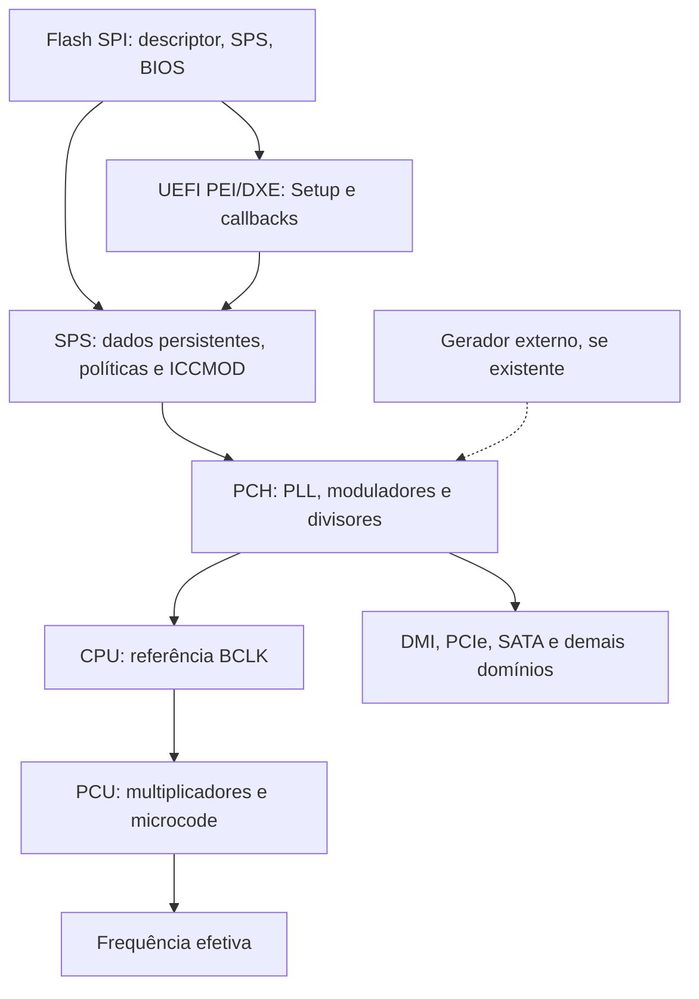

# Etapa 11 — Investigação ativa: BCLK, SSC, ICC e caminhos alternativos

> **ETAPA ATUAL — levantamento de requisitos e estudos técnicos (R&D).**
> Data de referência: 26/11/2026.
> Este documento reúne os 12 tópicos da análise de continuidade, em um único contexto operacional. É o ponto de partida para a próxima sessão de pesquisa.
> Nenhum overclock acima de 2,9 GHz all-core foi demonstrado na QIYIDA X99-H9S; nenhuma imagem modificada foi gravada.

A rejeição de um mecanismo convencional não demonstra que todas as alternativas sejam impossíveis. Investigar separadamente as restrições do silício, microcode, BIOS, SPS e gerador físico de clock. Investigar inclusive diferenças mínimas, callbacks, opções ocultas, estruturas persistentes e variantes de inicialização, mas distinguir pistas de evidências comprovadas.

**Objetivo:** investigar dois mecanismos complementares para elevar a frequência efetiva do E5-2680 v4: (A) controle do BCLK, mesmo que a primeira alteração observável seja de apenas 0,25 MHz, e (B) desbloqueio efetivo do multiplicador e dos limites turbo all-core do próprio processador. O ratio 29x é o baseline, não uma restrição de projeto. Se ambos os mecanismos forem demonstrados, investigar sua combinação. A alteração de clocks compartilhados é aceitável como hipótese experimental. A integridade de dados e a recuperação continuam requisitos.

**Contexto técnico anterior:** [documento consolidado](../xeon-e5-2680v4-h9s-pesquisa-bclk-icc.md), [comandos e resultados](09-caderno-comandos-resultados.md), [mapa de funções](10-mapa-funcoes-estruturas.md). Os resultados históricos abaixo não constituem novos testes. Referências externas são pistas recuperadas da última análise, não uma nova auditoria independente de todos os links.

## 1. Precedentes externos — investigar evidências de BCLK em Xeon v4

| Fonte | Frequência registrada na análise anterior | Data informada |
|---|---:|---|
| [HWBOT Cinebench R20 #5236397](https://esports.hwbot.org/benchmarks/cinebench_-_r20/submissions/5236397) | 3000,12 MHz | 2023 |
| [HWBOT Cinebench R15 #6057406](https://esports.hwbot.org/benchmarks/cinebench_-_r15/submissions/6057406) | 3009,89 MHz | 2026 |
| [HWBOT Cinebench 2026 #6088481](https://esports.hwbot.org/benchmarks/cinebench_-_2026_multiple_threads/submissions/6088481) | 3007,91 MHz | 2026 |
| [HWBOT Cinebench R11.5 #5749232](https://esports.hwbot.org/benchmarks/cinebench_-_r11.5/submissions/5749232) | 3415 MHz | 2025 |
| Relato comunitário no fórum ASRock sobre X99M Extreme4 (janeiro de 2017) | BCLK de 103 MHz | URL específica ainda precisa ser recuperada |

O registro R15 de 3009,89 MHz foi associado na análise anterior à Gigabyte GA-X99-UD3P e ao E5-2680 v4. A identificação da revisão, versão de BIOS, BCLK, multiplicador e frequência efetiva de todos os núcleos ainda precisa ser confirmada. Os demais registros devem ser tratados como pistas, não provas independentes de overclock all-core.

**Pergunta:** existe uma diferença na implementação do controle de clock de placas X99 HEDT que permita elevar BCLK independentemente dos limites convencionais de ratio de Broadwell-EP?

Não afirmar que o Xeon v4 é universalmente desbloqueável, nem que nunca foi submetido a alteração de BCLK. O objetivo específico é demonstrar um mecanismo reproduzível na configuração C612/SPS investigada.

## 2. Camadas de controle e estado de partida

| Parâmetro | Estado histórico |
|---|---|
| CPU / CPUID | Intel Xeon E5-2680 v4, 14C/28T, Broadwell-EP, 0x406F1 |
| Placa | QIYIDA X99-H9S V1.21 |
| Chipset | Intel C612, LPC PCI 8086:8d44 |
| Firmware | AMI UEFI / Intel SPS 03.01.03.072, Grantley |
| SPI | 16 MiB |
| BCLK nominal | 100 MHz |
| All-core observado | ~2893–2900 MHz |
| Ratio solicitado / efetivo | 33x / 29x em carga |
| Microcode BIOS / Linux | 0x0b000038 / 0x0b000040 |
| MSR PLATFORM_INFO 0xCE | 0xa0080c3bf2811800, bits 28–30 zero |
| MSR 0x194 | 0; OC bins zero |
| MSR 0x1AD | 0x1d1d1d1d1e1f2121 |
| OC Mailbox capabilities | 0x221, RatioOcSupported=0 |
| Pedido ratio 30x | 0x500000000; completion 5, rejeitado |
| MSR 0x61E | leitura falhou no Linux |
| HECI/MEI | dispositivo exposto; HBM não inicializou |
| Imagem modificada gravada | nenhuma |
| Recuperação física validada | pendente |



Diagrama conceitual de dependências, não uma sequência de boot observada. Topologia física da H9S ainda desconhecida.

| Camada | Questão |
|---|---|
| Silício CPU | O limite de ratio decorre de fusíveis, lógica interna, microcode, política de inicialização ou combinação dessas camadas? O BCLK pode ser alterado independentemente? |
| Microcode/PCU | Existem capacidades, diferenças de versão, políticas de turbo ou pré-condições alternativas que permitam elevar o ratio efetivo? |
| BIOS UEFI | Qual rotina aplica os dados do setup ao hardware? |
| SPS/ICC | Onde estão os parâmetros, limites e perfis de clock? |
| Gerador físico | Qual PLL/modulador fornece efetivamente o BCLK do CPU? |

Não repetir o pedido de ratio 30x nem o mesmo bypass de identificação SPS no driver MEI como se fossem novos métodos.

## 3. Matriz completa de linhas de investigação

| ID | Linha | Prioridade | Dificuldade | Próxima evidência necessária |
|---|---|---|---|---|
| H01 | Spread Spectrum (SSC) | Muito alta | Média | Demonstrar aplicação de um parâmetro de modulação |
| H02 | Perfis ICC persistentes | Muito alta | Alta | Identificar estruturas MFSB/SCA/MFS |
| H03 | BIOS X99 funcional candidata | Muito alta | Média | Rastrear caminho de aplicação do BCLK na referência |
| H04 | MOD3, PLL e divisores | Alta | Muito alta | Mapear frequência, codificação e domínio físico |
| H05 | Gerador externo | Alta | Média | Identificar componente e topologia |
| H06 | HECI antes de End of POST | Alta | Alta | Identificar cliente/protocolo e fase disponível |
| H07 | Callbacks IntelSetup | Alta | Alta | Mapear QID, VarStore, callback e consumidor |
| H08 | PCU Mailbox alternativo e desbloqueio do ratio | Alta | Muito alta | Determinar semântica, domínio, limites e pré-condições das rotinas |
| H09 | BCLK Strap | Média | Alta | Identificar origem e programação de strap |
| H10 | Patch seletivo OcInit/PpmInitialize | Alta | Alta | Distinguir guards de software, exceções e imposição efetiva pelo CPU |
| H11 | Microcode e limites turbo Broadwell-EP | Alta para estudo offline | Muito alta | Comparar revisões compatíveis e identificar diferença relevante em 406F1 |
| H12 | Referência física do clock | Último recurso | Muito alta | Esquema, componente, limites e medição elétrica |

Prioridades indicam valor da informação e facilidade relativa de investigação; não são probabilidades de êxito. Nenhuma hipótese deve ser considerada verdadeira apenas porque há um menu, uma instrução ou um registrador associado a clock. Evitar alterações arbitrárias em proteções elétricas e térmicas.

## 4. Spread Spectrum — primeira prova mínima de controle

### 4.1 Motivação matemática

Com ratio 29x e frequência observada de aproximadamente 2893 MHz:

```text
BCLK estimado = 2893 / 29 = 99,75862069 MHz
```

No IFR da H9S foi observado o texto:

```text
Default Clock Settings
100.00 MHz 0.50% Downspread
```

Modelo idealizado de modulação descendente de 0,5%, simétrica no tempo entre o máximo e o mínimo:

```text
f_max = 100 MHz
f_min = 100 * (1 - 0,005) = 99,5 MHz
f_media = (100 + 99,5) / 2 = 99,75 MHz
f_CPU_media = 99,75 * 29 = 2892,75 MHz
```

| Condição teórica | BCLK médio | All-core 29x |
|---|---:|---:|
| Downspread 0,5% idealizado | 99,75 MHz | 2892,75 MHz |
| Sem SSC | 100 MHz | 2900 MHz |
| Primeiro OC | 101 MHz | 2929 MHz |

A proximidade entre 2893 MHz e 2892,75 MHz é um indício, não prova de SSC ativo. O texto IFR pode ser um placeholder. TSC, APERF/MPERF, arredondamento, carga e método de medição podem explicar diferenças semelhantes.

Recuperar 0,25 MHz representa cerca de 0,25% de ganho nominal de frequência. O valor do experimento é comprovar causalidade e controle do gerador, não o ganho em si. Desativar SSC não constitui overclock acima de 100 MHz e não garante ajuste da frequência central.

### 4.2 Campos IFR relevantes

Offsets relativos ao payload IntelSetup (0x17EC bytes), não offsets SPI:

| Campo | Offset | Observação |
|---|---:|---|
| ICC Profile | 0x12EF | default 0, dependente de OEM |
| ICC Profile editable | 0x12F0 | flag dinâmica |
| DMI frequency | 0x12F9 | WORD; unidade desconhecida |
| PCI frequency | 0x12FB | WORD; unidade desconhecida |
| DMI spread / PCI spread | 0x12FE / 0x12FF | campos de modulação |
| DMI/PEG ratio | 0x1301 | enumeração de divisores |
| DMI/PCI visible | 0x1304 / 0x1305 | flags dinâmicas |
| DMI/PCI editable | 0x1307 / 0x1308 | flags dinâmicas |
| ICC Locks after EOP | 0x130F | política de acesso |
| ICC editable | 0x1311 | flag dinâmica |
| SSC override | 0x132B | override/auto |
| SSC0–SSC7 mode | 0x132C–0x1333 | modos de spread por domínio |
| External SSC CK420 | 0xF5 | não comprova presença do chip |

Os modos SSC encontrados incluem down, center, disable, do not change e auto. Conferir enumeração e VarStore no IFR original antes de qualquer interpretação. A existência de um campo não prova que ele seja usado.

### 4.3 Procedimento experimental proposto

1. Rastrear o caminho real de configuração SSC, sua representação e consumidor.
2. Encontrar método compatível com C612/SPS 3.1 para ler ou interpretar o perfil.
3. Produzir comparação offline entre duas configurações válidas que diferem apenas no SSC.
4. Verificar estrutura, integridade e mudanças não intencionais.
5. Quando houver recuperação física validada, realizar teste A/B reversível em ambiente isolado.
6. Medir múltiplas vezes ratio, frequência, carga equivalente e desempenho, com referência temporal independente quando possível.
7. Restaurar o original e conferir se a alteração observável desaparece.

**Aceitação:** diferença reproduzível e causalmente ligada ao parâmetro. Se não houver diferença, verificar resolução da medição, perfil ativo, callback e saída física antes de descartar a hipótese.

## 5. Engenharia reversa de referência X99 — Gigabyte GA-X99-UD3P

Referência candidata: [página oficial de suporte da GA-X99-UD3P rev. 1.0](https://www.gigabyte.com/latam/Motherboard/GA-X99-UD3P-rev-10/support). A revisão e BIOS efetivamente usadas no benchmark ainda são desconhecidas. Não transplantar a imagem na H9S.

| Componente | Comparação pretendida |
|---|---|
| Descriptor | chipset, straps, regiões, políticas |
| Intel ME versus SPS | versão, SKU, configuração ICC e formatos |
| IccOverClocking | comandos, headers, parâmetros, status |
| IccPlatform | gates, tipo de firmware e interface |
| Setup/Platform | FormSets, opções BCLK, QIDs e VarStores |
| Callbacks UEFI | caminho HII/ConfigAccess até a aplicação |
| OcInit | inicialização do clock, capacidades, straps |
| PlatformCpuPolicy/PpmInitialize | separar política de ratio de BCLK |
| Perfis ICC | frequência, SSC, divisores, limites |
| Módulos OEM | eventual implementação própria de gerador externo |

### Procedimento offline

- Baixar versão oficial compatível com Broadwell-EP; registrar URL, revisão, versão, data, tamanho, SHA-256.
- Identificar formato da imagem, cápsula, descriptor e presença ou ausência da região ME. Uma atualização oficial pode conter apenas BIOS.
- Extrair FV/FFS e inventário de GUIDs; extrair IFR.
- Localizar opções BCLK, Host Clock, CPU Strap, SSC, seus callbacks e VarStores.
- Seguir referências cruzadas dos campos até o consumidor e a operação de clock.
- Comparar módulos por GUID, arquitetura e função, não apenas nome.
- Se houver amostras da mesma versão com uma única diferença de frequência/SSC, fazer diff binário.
- Identificar o que é compartilhado com a H9S e o que depende do hardware/ME desktop.

```text
reference-x99/
  manifest.json
  modules.csv
  ifr/
  protocol-map.md
  variable-map.md
  clock-callgraph.md
  comparison-h9s.md
```

Estrutura proposta; ainda não implementada. Binários e dados brutos permanecem fora do Git.

**Aceitação:** rastrear pelo menos um caminho desde a opção de frequência até um comando ou registro com semântica verificável. Não transplantar layout IntelSetup ou firmware de outra placa. Incompatibilidade identificada é um resultado útil.

## 6. Dados persistentes ICC no SPS — prioridade operacional

O datasheet C610/X99 descreve configuração de clock por firmware de gerenciamento e dados persistentes. Já extraímos código ICCMOD; falta interpretar a configuração utilizada pelo SPS original.

| Partição | Offset relativo SPS | Offset absoluto SPI | Tamanho |
|---|---:|---:|---:|
| Descriptor | — | 0x000000 | 0x1000 |
| MFSB | 0x001000 | 0x002000 | 0x10000 |
| SCA | 0x011000 | 0x012000 | 0x10000 |
| FTPR | 0x021000 | 0x022000 | 0x20000 |
| MFS | 0x041000 | 0x042000 | 0x40000 |
| OPR1 | 0x081000 | 0x082000 | 0x200000 |
| ASAP | 0x281000 | 0x282000 | 0x4000 |

Base SPI da região SPS: 0x001000. FPT relativo em 0x10. Não há partição explicitamente chamada ICC; isso não prova ausência de configuração ICC.

### 6.1 Referências cruzadas do ICCMOD

| Endereço/ID | Observação histórica | Investigação necessária |
|---|---|---|
| 0x200EF000 | base analítica do ICCMOD raw, 0x4000 bytes | preservar VMA e offsets |
| 0x200F0EF0 | loop candidato IccWorkerThread | origem e semântica dos eventos |
| 0x200EEAB0 | serviço interno comum | identificar implementação, tipo e direção |
| 0x200EEAC8 | serviço correlato | identificar leitura/escrita/persistência |
| ID 0x1F / 12 bytes | associado ao evento bit 9 | identificar estrutura |
| ID 0x3B / 8 bytes | associado ao evento bit 11 | identificar estrutura |
| bits 12/13 | chamadas correlatas com os mesmos IDs | confirmar semântica |
| 0x200EFDE8 | escrita mascarada no aux 0x12301 | determinar eventual vínculo com clock |
| 0x200EFE10 | rotina candidata de configuração | decodificar parâmetros |
| HOSTCOMM-200e1000.mod | extraído | registrar cliente, roteamento |
| POLICY-2009f000.mod | extraído | mapear gates e políticas |

Os IDs 0x1F e 0x3B são candidatos a identificadores internos, não offsets MFS nem comandos HECI confirmados. Pode haver relação com configuração persistente, volátil ou mensagens internas. Identificar primeiro os serviços e seus chamadores.

### 6.2 Métodos e ferramentas

| Ferramenta | Uso | Situação |
|---|---|---|
| [meimagetool](https://github.com/peterbjornx/meimagetool) | ME/MFS/configuração | compatibilidade SPS 3.1 desconhecida |
| [parseMFS](https://github.com/ptresearch/parseMFS) | análise MFS | compatibilidade pendente |
| [MEAnalyzer](https://github.com/platomav/MEAnalyzer) | identificação SPS/FPT | usado |
| [me-tools](https://github.com/skochinsky/me-tools) | formatos de gerações anteriores | Python 2 em parte |
| spsFITc | editor específico SPS | versão Grantley 3.1 compatível ainda não localizada |
| FITC ME 9.1 r7 | referência ICC desktop | não validado para SPS |
| CCT | referência de comandos de clock | não executado no SPS |

Arquivos como fitc.cfg são conhecidos em estudos de outras gerações de ME. O nome, formato e presença desse arquivo não estão demonstrados na H9S. Referência histórica de pacote SPS: SPS_E5_03.00.05.402.0_PV-G_WBG_REL; download e compatibilidade pendentes.

### 6.3 Inventário dos volumes

- Validar hash, tamanho e mapa FPT.
- Mapear regiões preenchidas/apagadas, assinaturas, páginas, periodicidade, alinhamento, entropia e possíveis registros.
- Investigar redundância, seleção de cópia ativa, cabeçalhos, checksums e autenticação.
- Testar parsers externos em cópias e confrontar cada interpretação com os bytes brutos.
- Cruzar registros candidatos com serviços e consumidores do ICCMOD.
- Registrar campos desconhecidos explicitamente; não usar ocorrência isolada de 100 ou 100000000 como prova de frequência.

**Aceitação:** identificar registro candidato de configuração ICC com limites, tipo e origem justificáveis, apoiado em referência cruzada de código ou ferramenta compatível. Nenhum patch de frequência até entender a estrutura.

## 7. MOD3, PLL e matemática dos divisores

Referência: [Intel C610/X99 PCH Datasheet](https://www.intel.com.tw/content/dam/www/public/us/en/documents/datasheets/x99-chipset-pch-datasheet.pdf), capítulo 4, especialmente tabelas de moduladores e seções 4.5/4.6. A associação do MOD3 a CLKOUT_DMI/BCLK e domínios relacionados é documentada; a atuação exata no C612 desta placa precisa ser validada. O datasheet distingue capacidades HEDT.

| Representação possível | Evidência necessária |
|---|---|
| Frequência em unidades inteiras ou escaladas | unidade e faixa confirmadas |
| Divisor inteiro | clock de origem, divisor e saída |
| Divisor fracionário | numerador/denominador e formato |
| Campo packed em bits | máscara, posição, tipo e referência |
| Parâmetro de modulação | efeito na frequência instantânea/média |
| Limite min/max | diferenciar autorização de valor efetivamente aplicado |

Não pressupor que o perfil armazene 100 MHz literalmente. Um modelo genérico de síntese pode ter a forma f_out = f_ref × N/M × 1/P; a fórmula real e o significado de N, M e P não foram estabelecidos para o hardware. Buscar comparações diferenciais com uma única mudança conhecida.

Registradores auxiliares ARC 0x10005, 0x12301, 0x12302 e 0x8011 foram observados. Nenhum foi mapeado ao MOD3. A escrita mascarada em 0x12301 preserva bits fora da máscara, mas a função física é desconhecida. Não aplicar valores deduzidos sem compreender o registro.

**Meta:** ligar parâmetro de perfil -> rotina consumidora -> registrador/modulador -> saída física -> frequência medida. Clocks acoplados são aceitáveis, porém não se presume que todos mudem na mesma proporção.

## 8. Comunicação ICC durante o boot — HECI antes de EOP

| Fase | Investigação |
|---|---|
| PEI | PPIs, políticas antecipadas, OcInit, inicialização do SPS |
| DXE | protocolos HECI e ICC, IccPlatform/IccOverClocking |
| End of POST (EOP) | condições e políticas de acesso a comandos/perfis |
| Runtime | Linux MEI, exposição PCI, HBM e disponibilidade de clientes |

A tentativa Linux encontrou HECI 8086:8d3a, HFS1 0x000f0392, BAR0 realocado para 0xB4000000 e CSRs 0x80020209. O driver padrão rejeitou SPS; a variante experimental não iniciou HBM. Não houve /dev/mei0 nem resposta ICC. Não concluir que o timeout tenha sido causado por EOP ou IRQ.

### Pontos de código já identificados

| Componente | Endereço / achado |
|---|---|
| SpsPei/SpsDxe/HeciInitDxe | controle de visibilidade FD2 |
| IccPlatform 0x96C | classificação de modo via HFS1; nibble f -> tipo 1 |
| IccPlatform 0x430/0xAA8 | caminhos que exigem tipo 2 |
| IccPlatform 0x9A8 | mensagem de 32 bytes, comando 3, sem semântica confirmada |
| IccOverClocking 0x100003C0 | wrapper de transporte |
| HECI GUID | CFB33810-6E87-4284-B203-A66ABE07F6E8 |
| Endereços lógicos da BIOS | host 0x00, destino ME 0x08 |
| Requisição candidata 0x06 | header de 20 bytes, gerado offline e nunca transmitido |
| ICC Locks after EOP | IntelSetup +0x130F |

A disponibilidade de uma aplicação UEFI antes de ExitBootServices não garante que ela execute antes de End of POST. Confirmar a ordem efetiva, dependências DEPEX, protocolo e momento de EOP. Uma aplicação UEFI diagnóstica poderá identificar interfaces e, somente quando a semântica estiver conhecida, executar consultas suportadas. Não desabilitar EOP/HMRFPO ou locks de forma genérica.

### Linhas complementares de boot

- Rastrear callbacks dos QIDs 0x10B0/0x10B1/0x10B2/0x10B5 e flags dinâmicas do IntelSetup.
- Investigar qual código consome o perfil selecionado antes e depois de EOP.
- Revisar o PCU Mailbox em OcInit 0x677A (interface/dados f8040/f8044) e o transporte MMIO +0x5DA0/+0x5DA4. São espaços distintos.
- A rotina 0x647E sincroniza estado de strap, mas não prova programação de novo strap.
- O guard RatioOcSupported em 0x4B8C/0x4B90 precede leitura do MSR61E. A leitura falhou no Linux. Não remover esse salto cegamente.
- Microcode anterior só deve ser investigado com evidência específica para CPUID 406F1 e máscara de plataforma; nenhum downgrade foi realizado.

**Aceitação:** identificar uma fase e interface que ofereçam consulta documentada/validada, com retorno interpretável e relação demonstrável com o ICC. Não confundir protocolo localizado com protocolo acessível.

## 9. Gerador físico de clock e topologia da H9S

O C612 admite topologia integrada nativa, híbrida ou gerador externo CK420BQ conforme documentação do chipset. Ainda não sabemos qual foi montada nesta revisão H9S.

| Evidência histórica | Limite |
|---|---|
| IntelSetup +0xF5 External SSC CK420 | opção genérica, não identifica chip físico |
| PCHSTRP17 0x144 = 0x00000002 | bits 7=0, 1=1, 0=0; polaridades não confirmadas |
| SMBus 8086:8d22, 00:1f.3 | controlador I801 observado |
| BAR0 f8315000–f83150ff | janela MMIO SMBus |
| BAR4 I/O 0x0580–0x059F | janela I/O do mesmo controlador |
| i2c-0 e barramentos NVIDIA | ausência de clientes registrados não prova ausência de PLL |
| Protocolo EFI SMBUS HC | E49D33ED-513D-4634-B698-6F55AA751C1B |
| IioInit, PlatformType, PchSmbusDxe, MtrrS3SaveRestoreSmm | referências ao protocolo, sem programação PLL comprovada |

Quando houver acesso físico, identificar cristal de referência, PLL/clock generator, buffers, marcações dos CIs, datasheets, topologia e roteamento. Confirmar esquema/revisão, níveis elétricos e método de medição apropriado. Se houver componente externo programável, estudar a interface documentada como ramo independente do ICC.

Não realizar varredura SMBus indiscriminada ou escritas em endereços presumidos; SPD, VRM e outros componentes podem compartilhar o barramento. A alteração física da referência de 25 MHz fica como último ramo teórico, pois pode afetar múltiplos domínios e não foi comprovado que essa alteração seja apropriada ao circuito da H9S.

## 10. Projeções de frequência e critérios de medição

| BCLK | All-core 29x | Turbo máximo 33x | Ganho nominal vs 100 MHz |
|---:|---:|---:|---:|
| 99,75 MHz | 2892,75 MHz | 3291,75 MHz | -0,25% |
| 100 MHz | 2900 MHz | 3300 MHz | baseline |
| 101 MHz | 2929 MHz | 3333 MHz | +1% |
| 102 MHz | 2958 MHz | 3366 MHz | +2% |
| 103 MHz | 2987 MHz | 3399 MHz | +3% |
| 104 MHz | 3016 MHz | 3432 MHz | +4% |
| 105 MHz | 3045 MHz | 3465 MHz | +5% |
| 107 MHz | 3103 MHz | 3531 MHz | +7% |
| 110 MHz | 3190 MHz | 3630 MHz | +10% |
| 125 MHz | 3625 MHz | 4125 MHz | +25%, strap teórico |

Fórmula: f_CPU = BCLK × ratio. A frequência de 33x é turbo máximo nominal, não all-core. Para 105 MHz, o ganho teórico frente ao baseline observado de 2893 MHz é aproximadamente 5,25%. Nenhum valor acima dos 100 MHz nominais foi demonstrado na H9S.

Não aceitar somente frequência exibida por DMI ou valor solicitado ao MSR. Medir Bzy_MHz e Busy%, ratios, carga equivalente, tempo independente quando possível e desempenho real. Verificar AER, MCE, EDAC, PCIe, NVMe, SATA, USB, rede, temperaturas e throttling. Testar integridade de arquivos descartáveis com hashes e manter backup fora da máquina. Uma alteração pequena exige resolução de medição suficiente e repetição A/B.

Para qualquer teste persistente: acesso físico, recuperação SPI previamente validada e armazenamento de teste recuperável. Interromper diante de ausência de POST, erro de memória/I/O, divergência de hash, resets de link ou instabilidade. Não avançar apenas porque o sistema ainda inicia.

## 11. Próxima ação concreta — coletar MFSB, SCA e MFS

O próximo insumo obrigatório é a configuração persistente. A coleta abaixo usa a cópia original já obtida; não acessa a flash física e não modifica o original. O diretório de saída deve ser novo; se existir, preservar seu conteúdo e escolher outro diretório.

```bash
cd ~/backup-bios
python3 - <<'PY'
from pathlib import Path
import hashlib

rom = Path("x99-h9s-original.bin").read_bytes()
expected = (
    "6036511afaaeab53701e0adce3a3a731790"
    "302f24ca11614212f95f2901fce5b"
)
actual = hashlib.sha256(rom).hexdigest()
if len(rom) != 16 * 1024 * 1024 or actual != expected:
    raise SystemExit("Dump diferente da referencia; interromper.")

regions = {
    "descriptor": (0x000000, 0x1000),
    "MFSB": (0x002000, 0x10000),
    "SCA":  (0x012000, 0x10000),
    "MFS":  (0x042000, 0x40000),
}

folder = Path("sps-icc-research")
folder.mkdir(exist_ok=False)
manifest = [f"original sha256={actual}"]

for name, (offset, size) in regions.items():
    data = rom[offset:offset + size]
    if len(data) != size:
        raise SystemExit(f"Regiao truncada: {name}")
    (folder / f"{name}.bin").write_bytes(data)
    line = (
        f"{name} spi=0x{offset:06x} size=0x{size:x} "
        f"sha256={hashlib.sha256(data).hexdigest()}"
    )
    print(line)
    manifest.append(line)

(folder / "manifest.txt").write_text("\n".join(manifest) + "\n")
PY
```

Somente após execução sem erros:

```bash
tar -czf sps-icc-research.tar.gz sps-icc-research
tar -tzf sps-icc-research.tar.gz
sha256sum sps-icc-research.tar.gz
xdg-open ~/backup-bios
```

O tamanho bruto esperado dos quatro arquivos é 397312 bytes (4 KiB + 64 KiB + 64 KiB + 256 KiB), excluindo manifesto. O tamanho comprimido não é fixo. Enviar o pacote privadamente para análise; não publicar volumes brutos no GitHub.

**Pendente:** pacote ainda não recebido nesta etapa. Não inventar a localização de um perfil ICC e não solicitar repetição de testes de CPU/HECI que já foram concluídos. A primeira operação após o recebimento será verificar manifesto e mapear estruturas.

## 12. Estratégia de continuação — ordem, entregas e critérios

| Ordem | Trabalho | Entrega | Condição para avançar |
|---:|---|---|---|
| 1 | Coletar e interpretar MFSB/SCA/MFS | inventário de estruturas, hashes e campos candidatos | limites e referências cruzadas conhecidos |
| 2 | Estudar firmware oficial Gigabyte X99 | mapa de opções, callbacks, mensagens e diferenças | mecanismo candidato identificado |
| 3 | Controlar SSC | comparação offline A/B e teste recuperável | alteração mínima observável e reversível |
| 4 | Identificar controle de frequência | mapa MOD3/PLL/divisores/limites | parâmetro causal validado |
| 5 | Demonstrar 101 MHz | primeiro overclock efetivo, 2929 MHz teóricos a 29x | medição e integridade confirmadas |
| 6 | Investigar 103–110 MHz | resultados graduais, estabilidade e desempenho | validar cada passo antes de avançar |
| 7 | Investigar BCLK Strap | pré-condições e mecanismos identificados | somente se houver suporte e evidência |

As frentes 1 e 2 podem ocorrer em paralelo. A frente SSC é a primeira meta experimental mínima, não uma exigência de que todo método de BCLK passe por SSC. Caso uma hipótese falhe, registrar evidência negativa, revisar a causa e prosseguir com a alternativa de maior valor informacional. Os demais ramos H05–H12 permanecem abertos quando houver dados novos que justifiquem a investigação.

### Frente paralela — desbloqueio efetivo do processador

O resultado negativo do comando OC Mailbox 0x11 não encerra a investigação de multiplicador. Ele demonstra somente que a solicitação testada foi rejeitada nas condições observadas. O retorno 0x221 da consulta de capacidades informa RatioOcSupported=0; a solicitação 30x retornou completion 5. Não há prova suficiente para atribuir a restrição exclusivamente a fusíveis físicos, exclusivamente ao microcode ou exclusivamente à BIOS.

| Alvo | Evidência atual | Próxima investigação |
|---|---|---|
| MSR 0xCE e 0x194 | bits de capacidade e OC bins zero | comparar significado documentado e comportamento em CPUs Broadwell-EP com capacidades diferentes |
| MSR 0x1AD/0x1AE/0x1AF | tabelas turbo observadas; 29x all-core | identificar quem carrega as tabelas e onde o CPU impõe o limite |
| PpmInitialize | guards em 0x2445–0x2454 | reconstruir fluxo de política e distinguir condição de software de rejeição de hardware |
| OcInit | guard RatioOcSupported em 0x4B8C/0x4B90 | rastrear rotinas de ratio sem presumir que remover o guard desbloqueie o CPU |
| PlatformCpuPolicy/CpuMpPei/CpuMpDxe | módulos extraídos | mapear estruturas, momento de inicialização e consumidores |
| OC Mailbox/PCU | MSR 0x150 e caminhos privados distintos | comparar documentação, semântica, domínios e respostas sem repetir escritas rejeitadas |
| Microcode | BIOS 0x0b000038; Linux 0x0b000040 | inventariar revisões com CPUID e platform mask compatíveis; estudar diferenças offline |
| Referências de Xeon v3 e modelos v4 | precedentes arquiteturais | verificar diferenças de geração; não presumir compatibilidade de técnicas |

**Sequência de pesquisa:** (1) estabelecer modelo causal da limitação de ratio; (2) comparar inicialização e políticas com processadores/firmwares de referência; (3) identificar divergências verificáveis de código, capacidade ou estado; (4) propor experimento isolado e recuperável somente quando houver hipótese testável; (5) verificar ratio efetivo sob carga equivalente.

Critério mínimo de êxito dessa frente: demonstrar 30x sustentado sob carga dos 14 núcleos a BCLK nominal de 100 MHz, com frequência e desempenho coerentes, sem erros nos testes executados. 31x, 32x e 33x all-core são metas teóricas subsequentes, não capacidades comprovadas. Não confundir turbo de poucos núcleos com desbloqueio all-core. Não confundir remoção de um guard da BIOS com mudança de um fusível físico; nenhum mecanismo de alteração de fusíveis está demonstrado.

| Ratio all-core hipotético | BCLK 100 MHz | BCLK 105 MHz |
|---:|---:|---:|
| 29x (baseline de ratio) | 2900 MHz | 3045 MHz |
| 30x | 3000 MHz | 3150 MHz |
| 31x | 3100 MHz | 3255 MHz |
| 32x | 3200 MHz | 3360 MHz |
| 33x | 3300 MHz | 3465 MHz |

Todos os cenários acima do baseline são projeções, não medições. A investigação de desbloqueio não autoriza desabilitar proteções de corrente, tensão ou temperatura; qualquer experimento persistente depende dos critérios de recuperação já definidos.

### Backlog imediato

- [ ] Receber e validar pacote sps-icc-research.tar.gz.
- [ ] Inventariar estruturas MFSB/SCA/MFS, inclusive redundância e integridade.
- [ ] Testar compatibilidade de parsers sem modificar imagens.
- [ ] Rastrear IDs 0x1F e 0x3B a seus serviços e registros.
- [ ] Localizar spsFITc compatível com Grantley 3.1 ou referência diferencial equivalente.
- [ ] Obter imagem oficial da GA-X99-UD3P e gerar manifesto.
- [ ] Rastrear callbacks BCLK/SSC e consumidores das variáveis.
- [ ] Validar representação de frequência e modulação.
- [ ] Confirmar topologia física do clock.
- [ ] Preparar baseline de medição e recuperação física.
- [ ] Demonstrar alteração mínima do gerador de clock.
- [ ] Demonstrar frequência acima de 100 MHz nominais e ganho efetivo.
- [ ] Reconstruir o fluxo de carregamento e imposição dos limites turbo em PpmInitialize e políticas CPU.
- [ ] Comparar microcodes compatíveis e referências de Broadwell-EP, sem downgrade nesta fase.
- [ ] Identificar uma hipótese de desbloqueio de ratio verificável e demonstrar pelo menos 30x all-core, se viável.
- [ ] Avaliar combinação de ratio e BCLK somente após validação independente.

### Regra para retomar

Antes de propor outro teste, consultar este arquivo e as etapas 01–10. Identificar qual hipótese será testada, qual evidência nova é esperada e por que o teste não repete um resultado anterior. Distinguir endereço localizado de função compreendida; função compreendida de comando suportado; comando suportado de alteração física; alteração física de overclock estável.

**Estado final:** fase de estudos e levantamento de requisitos. Duas frentes ativas: controle BCLK via ICC/SPS, com comparação X99 e SSC, e investigação de desbloqueio do processador via políticas turbo, PCU, microcode e firmware UEFI. A primeira coleta MFSB/SCA/MFS permanece a próxima ação operacional do ramo ICC, enquanto a análise offline de ratio pode avançar em paralelo. Não existe ainda offset comprovado de frequência, patch de BCLK validado, desbloqueio de ratio demonstrado ou firmware pronto para gravação.

## Referências complementares

- [Intel Xeon E5 v4 — Registers, volume 2](https://www.intel.com/content/www/us/en/content-details/333810/intel-xeon-processor-e5-v4-family-volume-2-of-2-registers-datasheet.html).
- [Intel C610/X99 PCH Datasheet](https://www.intel.com.tw/content/dam/www/public/us/en/documents/datasheets/x99-chipset-pch-datasheet.pdf).
- [Linux MEI driver v7.0](https://github.com/torvalds/linux/tree/v7.0/drivers/misc/mei).
- [coreboot](https://github.com/coreboot/coreboot) — referência de protocolos e implementações, não prova de compatibilidade.
- [Ferramentas X99, ME 9.1 FITC/CCT](https://github.com/avkila-tech/ALL-X99-BIOS-TOOLS/tree/main/TOOLS) — binários não autenticados nem validados para SPS.
- [Discussão SPS 3 Tools](https://winraid.level1techs.com/t/sps-3-tools/37875/8) — pacote candidato não obtido.
- [Pesquisa consolidada e referências anteriores](../xeon-e5-2680v4-h9s-pesquisa-bclk-icc.md).

Não incluir neste documento nem no repositório informações de outros projetos, dados pessoais, dumps integrais ou binários proprietários.
