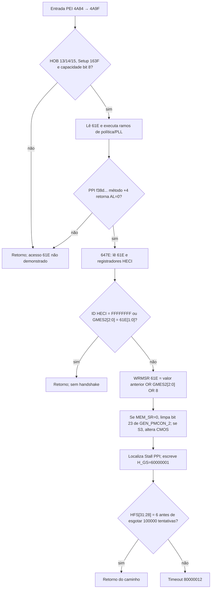

# Etapa 17 — M1, BIOS B1 e caminhos de clock

Data: 27/11/2026. Pesquisa exclusivamente offline. Estado físico: nenhum novo teste, escrita, alteração NVRAM ou flash; EOP restaurado conforme etapa 16. Hipótese principal: a M1, uma família de firmware distinta, pode oferecer comportamento de inicialização ICC diferente do SPS original. Seria refutada para um experimento específico por inicialização igual e ausência de efeito mensurável, mas falha de POST por si só não refuta todos os mecanismos de BCLK.

## 17.1 Fontes e preservação

[Publicação original e pacote 260614](https://winraid.level1techs.com/t/guide-overclock-bios-mods-for-chinese-x99-mbs/104683/134): autor recomenda B1 para v4, associa M1 a X99Z V102, XD4 e H9S e pede conferir IIO 0; essa associação de H9S remete a [relato de terceiro](https://winraid.level1techs.com/t/guide-overclock-bios-mods-for-chinese-x99-mbs/104683/187), sem validação independente de revisão, estabilidade ou CPU v4. O [CPU-Z hlp6cj](https://valid.x86.fr/hlp6cj) informa H9S/C612, E5-2680 v4 e 31 × 126,2 MHz, com microcode B000038; é uma captura, não prova de BCLK físico, carga sustentada, integridade, uso de M1 ou configuração comparável.

Arquivo original do link atualizado 260614 obtido de MEGA por API, decifrado localmente, `7z t`: todos os arquivos íntegros segundo o teste do arquivo; isso não autentica o autor. Dados guardados em `~/backup-bios/referencia-winraid-260614/`, fora do Git; extração seletiva. Nenhum executável baixado foi executado. Não confundir integridade local com assinatura de fabricante.

| Artefato | Tamanho bytes | SHA-256 |
|---|---:|---|
| `pacote-260614.bin` (260614_HNZ_BD4_mods.7z) | 6189014 | `05ba4df1a34a02dd167b34ceb1b88fe5f89e51f0316254aadb9de26b93f969b9` |
| `M1.rgn` | 8384512 | `5126dfb7712b42131fe2fd27b64b8932285f19ee72ec3aed3b508da76a5a337a` |
| `D1_Mx_B1_260614.bin` | 16777216 | `29646a594119e3b5514e4304cf78cd928acb7bff980b072d54e1b7f80be76c3a` |
| original e verificação H9S, cada | 16777216 | `6036511afaaeab53701e0adce3a3a731790302f24ca11614212f95f2901fce5b` |
| `sps-region.bin` | 8384512 | `04b63494d57ac598c026bff9fe7bb392e5129c5800ec5779dd247e57aec8f414` |
| `machinist-x99z-c612rd24.rom` | 16777216 | `e7b0c67bbfc83d852c51f56cc604481c432858c8ba90ba34483ff55ff3a17c66` |

Inventário: `analise/` possui PE e ASM originais e IFR Platform; `overclock-mod/` contém ROM C612RD24, extração, OcInit, disassembly e diff; `sps-icc-research/` contém manifesto, descriptor, MFSB, SCA, MFS e mapas. Os quatro arquivos de região do manifesto foram conferidos por SHA-256, todos coincidentes. O hash dos dois dumps originais também coincide. A região M1 **não inclui** flash descriptor: não inferir straps ou tabela ICC de M1 a partir dos primeiros bytes dela.

## 17.2 Comparação ME/SPS e descriptor

**Estático, ferramenta ME Analyzer v1.312.0 r378:** original é SPS 03.01.03.072 Production, SKU GR, Grantley, data 2019-02-12; M1 é ME 9.1.40.1000 Production, SKU 1.5MB, LPT/WPT, data 2017-02-13, FIT 9.1.10.1000. MEA identifica padding em ambas. Suporte LPT/WPT não estabelece suporte efetivo da M1 ao C612/H9S; o relato H9S é evidência de comunidade para uma combinação, não prova desta revisão ou da BIOS original. O pacote B1 inicial foi baseado na Huananzhi BD4; o changelog documenta módulos de flash/NVRAM/PlatformType de outra placa e parâmetros IIO, além de OcInit proveniente de C612RD24. Isso não prova que firmware B1 e M1 isolada sejam intercambiáveis com a BIOS H9S.

FPT: origem dos offsets abaixo é o **início de cada região ME**, não SPI. Ambas assinaturas em +0x10, layout de cabeçalho 0x20/0x10/0x30. SPS: MFSB +0x1000/0x10000, SCA +0x11000/0x10000, FTPR +0x21000/0x20000, MFS +0x41000/0x40000, OPR1 +0x81000/0x200000, ASAP +0x281000/0x4000. M1: PSVN +0xbc0/0x40, FOVD +0xc00/0x400, MDES +0x1000/0x1000, FCRS +0x2000/0x1000, EFFS +0x3000/0x40000, GLUT +0x43000/0x4000, FTPR +0x47000/0x88000, NFTP +0xcf000/0x77000, MDMV +0x146000/0x37000; outras 11 entradas declaram offset FFFFFFFF, não tratadas como intervalos físicos. EFFS é candidato de persistência, sem decodificação de arquivos, ICC ou integridade neste trabalho. Não há correspondência demonstrada entre dados MFS/SCA e EFFS, nem associação de byte a frequência. Relatório de hashes e intervalos: `~/backup-bios/referencia-winraid-260614/fpt-comparacao.json` (pode incluir hashes sensíveis, manter local).

Descriptors das três imagens: FLREG2=07FF0001, intervalo SPI `[0x001000,0x800000)`, 0x7ff000 bytes; BIOS `[0x800000,0x1000000)`. Encaixe dimensional não comprova compatibilidade ou segurança. SHA descriptor H9S `9ee9d284bfec565e49bf5934e1d3800f8d57351844d7460bd09d281d44af9d4d`; B1 `eb656911ee73a1c2fe947517b178e687bee60430f97cc08b66f7947fd3b83477`; C612RD24 `6907d3129b4db9ba1351f1f692f76241c250d555c60efe7bb5093e818af2c403`. FLMAP2 declara RIL=27, ICCRIBA=0x21 na H9S e RIL=0, ICCRIBA=0x21 em B1 e C612RD24. Diferença de lista ICC **do descriptor**, não prova sobre o conteúdo de M1, nem instrução para substituir descriptor. Straps físicos/soft straps, valores reais e dependências de leitura ainda não comparados semanticamente.

A região ME embutida na B1 não é idêntica a M1: SHA-256 `bb7bf87470a0d2810875732684730930fce34580c628350b5e111dc33be03069`, 776313 bytes diferentes. Região C612RD24 SHA `975e2b391d6287d77bfe43efc24f0cd388a3a93afa01074edbbe3dc2d4c8c50d`, 707541 bytes diferentes de M1. Isso exclui presumir que o rótulo Mx da B1 já contenha M1. SPS e M1 diferem em 1434604 bytes de 8384512; não supor equivalência de partições ou de dados provisionados.

## 17.3 OcInit e campos de clock

OcInit GUID `6540F933-425F-464B-B4AD-B93A6ED0A8F5`; referência extraída da ROM C612RD24, não reextraída da B1 nesta sessão. Changelog B1 alega substituir OcInit pela C612RD24, mas identidade binária em B1 ainda não verificada. PE32 i386: H9S 9824 bytes SHA `fe142b302812a60830c3e059933547641c534c8ca27113a2a8637e77862c7dde`, image base FFDC47B4; C612RD24 6112 SHA `a8ebc035afb83b245f818994c1ebd4979399ad8312a337b0bbb93d9ec06e64a5`, base FFDC2F78. Bases e endereços seguintes são VMA PE, não offsets SPI. Layouts IntelSetup têm tamanhos 0x17EC e 0x17CB, respectivamente; troca isolada do módulo sem adaptação de layout não é candidata segura.

Na H9S FFDC4B5E testa IntelSetup[163F], e FFDC4B8C–90 testa capacidade antes da leitura MSR61E em FFDC4B96. Em FFDC4E9A há chamada a FFDC647E, que lê 61E, lê registro ECAM relativo B0060, compara campos, e no ramo de divergência escreve 61E em FFDC658B e acessa ECAM relativo F80A0; ver a sequência completa em `analise/OcInit.asm`. É sincronização condicionada, não comprovação de pedido de strap arbitrário. A referência C612RD24 também possui guard de capacidade em FFDC32C3–32D1 e transporte OC Mailbox, mas acesso a 61E não foi localizado no seu OcInit. O resultado negativo de busca se limita ao módulo e às representações analisadas.

| Opção IFR H9S / QID | VarOffset IntelSetup | Estado da ligação com hardware |
|---|---:|---|
| ICC Profile / 10B0 | 12EF | seletor 0–15, default 0; consumidor não resolvido |
| DMI Clock Frequency / 10B1 | 12F9, 16 bits | texto IFR 100 MHz/0,5% é placeholder; unidade, produtor e programação efetiva não resolvidos |
| DMI/PEG Ratio / 10B5 | 1301 | opções 5:5, 5:4, 5:3, 5:2; consumidor ainda não demonstrado |
| Filter PLL / E40 | 163E | PEI e gates HOB/GPIO detalhados na etapa 16; identidade H9S 07 é candidata, não 13 exigido |
| Adjust PLL / E41 | 17C1 | ajuda menciona mailbox; consumidor, comando e domínio não demonstrados |
| PLL Trim / E42 | 17C2 | campo IFR 32 bits; não se infere comando ou valor físico |
| Overclocking Feature | 163F | consumidor PEI também afeta caminho MSR620 de uncore; não prova turbo dos cores |

O nome CPU Strap e os pontos de programação de BCLK, perfil ICC, divisor e Adjust PLL não foram resolvidos nesta sessão. A presença de formulários, o envio HECI e o relato de outra CPU não comprovam qualquer efeito. Gates de modo/status ICC H9S e limitações de ratio estão na etapa 16; nenhuma repetição de EOP, MSR runtime ou ICC foi realizada.

## 17.4 Próximo experimento e condições para prosseguir

**Candidato conceitual, ainda não imagem aprovada:** comparar baseline original com imagem offline que mantenha descriptor e BIOS H9S byte a byte e substitua apenas região ME por M1; reversão com dump original verificado. Hipótese específica: com BIOS H9S e seu descriptor, M1 inicializa e expõe caminho de clock distinto. Este teste altera 0x7ff000 bytes e troca SPS por ME; não é uma alteração pequena em bytes, nem está demonstrado ser compatível. H9S+M1 difere do conjunto B1+M1 recomendado no fórum; resultado negativo pode decorrer da combinação, não do M1 ou C612 isoladamente. Nenhuma imagem foi construída: faltam análise das dependências BIOS SPS/ME, dados persistentes e provisionamento, efeito dos 27 pares ICC, verificação de descritores/straps e plano de validação pré-boot. A alternativa B1+M1 muda BIOS e descriptor e adiciona fatores; é controle posterior, não primeiro teste isolado. Não transplante FPT, EFFS, OcInit ou campos individuais.

Próximo passo executável offline: extrair e identificar módulos B1/C612RD24 ligados a ME/ICC e OcInit com ferramenta UEFI já verificada, comparar dependências PEI/DXE e strings/protocolos contra H9S; inspecionar EFFS com ferramenta que documente ME 9.1, sem assumir que seja MFS. Depois, se a compatibilidade e os limites forem compreendidos, produzir imagem em arquivo novo, hash e comparação com máscara exata da região ME, sem gravar. Qualquer flash, reboot ou mudança de NVRAM requer autorização específica; a confirmação de gravador/backups é relevante, mas não equivale a autorização de gravação. Preservar limites térmicos, elétricos e de corrente. Em eventual ensaio autorizado: baseline, recuperação SPI, inicialização e identificação de firmware, depois frequência efetiva com referência independente, carga e desempenho equivalentes, temperatura, throttling, PCIe/armazenamento e integridade em dados descartáveis. Interromper diante de falha POST, corrupção ou erros, restaurando backup conforme plano.

## 17.5 Reprodutibilidade e validação

- `python3 scripts/compara_fpt.py ../sps-region.bin '../referencia-winraid-260614/extraido/Step 2, choose ME/M1.rgn'` — relatório JSON de regiões explicitamente fornecidas, hashes e limites; reconhece somente layout legado observado, sem validar assinatura criptográfica, checksum FPT, sobreposições ou semântica de persistência. Offset FFFFFFFF tratado como não mapeado; não extrai nem escreve firmware.
- `python3 scripts/icc_descriptor.py --image h9s=../x99-h9s-original.bin --image b1='../referencia-winraid-260614/extraido/Step 1, B1 or B2 BIOS/D1_Mx_B1_260614.bin' --image c612rd24=../overclock-mod/machinist-x99z-c612rd24.rom` — lista de pares brutos; não interpreta seletores.
- `python3 -m unittest discover -s tests`: 34 testes passaram, incluindo fixtures sintéticas de FPT válido, entrada sem offset, limites, cabeçalho desconhecido e contagem excessiva.
- ME Analyzer exigiu terminal interativo no ambiente local; execução não interativa falhou em colorama e não foi usada como resultado. Python 3.14.4; objdump GNU 2.46; 7-Zip 26.00. Originais preservados.

## 17.6 Continuação — compatibilidade M1 e rotina 61E

Continuação solicitada após a publicação da etapa 17. Análise offline, sem repetir os testes de EOP, MSRs ou ICC. **Correção:** a tabela em 17.3 dizia que o consumidor de Adjust PLL não estava resolvido; os caminhos PEI abaixo foram identificados estaticamente. Isso não comprova que sejam alcançados na H9S nem que mudem o BCLK. A denominação anterior “sincronização” para 647E é uma descrição funcional parcial: a operação efetiva usa OR e não substitui necessariamente o campo.

### Módulos PEI/DXE — H9S, B1 e C612RD24

B1 foi extraída offline com `uefiextract` já instalado, UEFITool NE alpha 73; resultados em `~/backup-bios/referencia-winraid-260614/analise-b1/`, sem executar os módulos. A extração reportou JEDEC A12818/1C4018 desconhecidos e aviso de parsing ACM; isso limita a conclusão sobre a análise integral da imagem. C612RD24 e H9S usam extrações já existentes. Comparação de arquivos PE32/TE e DEPEX; identidade de DEPEX significa identidade de expressão binária, não de disponibilidade real do protocolo. “Ausente” significa não encontrado por nome ou GUID nos relatórios, não prova de inexistência de função equivalente sob outro GUID.

| Módulo / GUID | Comparação estática |
|---|---|
| HeciInit `4862aff3-667c-5458-b274-a1c62df8ba80` | DEPEX 18 bytes igual nas três; PE diferente |
| HeciInitDxe `55e76644-78a5-4a82-a900-7126a5798892` | DEPEX 36 bytes igual nas três; PE diferente |
| MeDxePolicyInit `24a44caf-0bf2-4514-90c4-c794b3e778f5` | DEPEX 72 bytes igual nas três; PE diferente |
| IccPlatform `14257b56-bda2-4faf-8e4f-c885df75583c` | DEPEX H9S=B1 108 bytes; C612RD24 72 bytes |
| IccOverClocking `5bba83e5-f027-4ca7-bfd0-16358cc9e123` | PE e DEPEX idênticos nas três; DEPEX contém protocolo HECI `cfb33810-6e87-4284-b203-a66abe07f6e8` |
| SpsPei `44640c32-33d7-4fb0-b1f9-6c7b232e994d` / SpsDxe `e8f6a75c-3cda-4b00-9837-8ca2a1f34eac` | presentes na H9S, ausentes por nome/GUID em B1 e C612RD24 |
| OcInit `6540f933-425f-464b-b4ad-b93a6ed0a8f5` | DEPEX H9S 18 bytes; B1=C612RD24 54 bytes; PE B1 e C612RD24 diferem no ImageBase e em 16 fixups HIGHLOW, mas coincidem após normalização de relocação; H9S é distinto |

DEPEX OcInit de B1/C612 inclui adicionalmente `2ab86ef5-ecb5-4134-b556-3854ca1fe1b4` e `f38d1338-af7a-4fb6-91db-1a9c2183570d`; funções dessas interfaces ainda não identificadas. Na H9S SpsDxe usa MKHI FF/0C para EOP no destino 7 sob gate de IntelSetup; IccPlatform exige modo 0 e status com nibble baixo 0 antes do comando 03 ao destino 8, conforme etapa 16. Em B1, IccPlatform RVA 9A8–A72 tem os mesmos gates estruturais de modo e status e envia comando 03, versão 30000h, host 0, destino 8; o modo efetivo e a resposta sob M1 não foram medidos. Compartilhamento de GUID ou código ICC não demonstra suporte operacional: o ambiente HECI, produtor do protocolo e política de firmware também importam.

| Combinação | Evidência e condição ainda aberta |
|---|---|
| H9S + SPS original | controle físico existente: MKHI versão respondeu; ICC 06 não respondeu mesmo no ensaio EOP=0. Caminhos SPS presentes. |
| H9S + M1 | hipótese de alto valor informacional, **não demonstrada compatível**: BIOS mantém SpsPei/SpsDxe, dependências e inicialização de plataforma SPS; não foi demonstrado que sejam incompatíveis de forma inevitável nem que funcionem com ME 9.1. Os 27 pares ICC e soft straps originais permanecem. |
| B1 + M1 | combinação recomendada no relato de terceiros; B1 não possui os módulos SPS identificados e usa OcInit da família C612RD24. Não foi validada nesta placa/revisão ou neste CPU. IIO e Super I/O continuam relevantes. |

**IIO e Super I/O:** IFR das duas BIOS: IOU2 offset 539, opção x4x4 valor 0, default em ambas; IOU1 offset 535, Auto FF, default em ambas; IOU0 offset 531, H9S marca x4x4x4x4 valor 0 como default, B1 não marca default na expressão examinada. O changelog B1 informa x4x4; x4x4x4x4; Auto, sem provar NVRAM real ou disposição física. As três contêm `NCT5532DPeiInit` GUID `9029f23e-e1ee-40d1-9382-36dd61a63eaa`, com PE diferentes. O nome não identifica o chip físico nem garante mapeamento de sensores, ventoinhas e pinos.

**EFFS e descriptor:** EFFS M1, intervalo relativo ME `[0x3000,0x43000)`, contém 72332 bytes diferentes de FF; foram encontradas literalmente uma ocorrência cada de NVCL/NVCP e três de Profile, nenhuma de ICC/BCLK. As três ocorrências pertencem a strings UserProfile, sem associação demonstrada a clock. Isso não interpreta arquivos, integridade ou perfil de clock. Fonte primária [Intel C610/X99, §§4.5–4.6](https://www.intel.com/content/dam/www/public/us/en/documents/datasheets/x99-chipset-pch-datasheet.pdf): firmware SPS/ME controla registradores de clock e PCHSTRP17 bits 7,1,0 selecionam o modo; o texto examinado não fornece aqui polaridade suficiente para determinar topologia apenas pelos bits. Usando FLMAP1 e a convenção de FPSBA do [ifdtool do coreboot](https://github.com/coreboot/coreboot/blob/main/util/ifdtool/ifdtool.c), as três imagens têm 21 DWORDs a partir de SPI 0x100 e PCHSTRP17 em SPI 0x144 = `00000002` (bits 7/1/0 = 0/1/0). PCHSTRP20 em SPI 0x150: H9S `00070000`, B1/C612RD24 `00380000`; bit 27 é zero em todas. Valores brutos não comprovam a topologia montada. Os 27 pares ICC H9S ocupam SPI [210h,2E8h); os seletores têm byte baixo E9/EA/EB e byte [23:16] 80/82/83/C0/C1, sem significado atribuído. Por exemplo SPI 210h tem selector 008340EB e valor 000805A6. Não foram decodificados até um registro com efeito físico; não assumir que a M1 os consuma da mesma forma nem os remover.

### OcInit H9S FFDC647E — fluxo e registradores

Endereços FFDCxxxx são VMA PE32, não offsets SPI. A entrada FFDC4A84 chama 4A9F; o único chamador direto identificado de 647E é 4E9A. O acesso depende de HOB plataforma byte +5E em 13/14/15, IntelSetup[163F] diferente de zero, consulta de capacidade OC Mailbox opcode 01 cujo resultado bit 8 alimenta RatioOcSupported, e interface PPI `f38d1338-af7a-4fb6-91db-1a9c2183570d` cujo método +4 retorna AL=0 antes da chamada. A identidade desse PPI não está resolvida. A resposta runtime histórica 0x221 tem bit 8 zero, mas não é medição da consulta em PEI. O HOB de identificação 07 da H9S é candidato com limite PHIT inconsistente, conforme etapa 16; não provar que este gate tenha sido avaliado assim durante PEI.

| Espaço/endereço | Operação observada e limite |
|---|---|
| MSR `61E` | 4B96 e 6497 leem; 6541–55A compara [1:0] a GMES2[2:0]. Se divergir, 6560–658B escreve `antigo OR (GMES2 & 7) OR 8`; bit 2 de origem pode ser setado e [1:0] antigos não são limpos. Bit 2 do MSR é extraído em 64A3–64BB, sem uso subsequente localizado. Ex.: 61E=2, GMES2=1 produz operando 11 decimal, low2=3, não 1. Sem documentação de efeito do WRMSR ou leitura válida PEI. |
| ECAM relativo `B0060` | BDF 00:16.0 offset 60h, GMES2, status geral preenchido pelo ME; [2:0] comparados no código. [Intel §24.1.1.20](https://www.intel.com/content/dam/www/public/us/en/documents/datasheets/x99-chipset-pch-datasheet.pdf) não define aqui esses bits como frequência ou strap. |
| ECAM relativo `B0000`, `B0040`, `B0048`, `B0064`–`B006C` | IDs/status lidos em 64BE–651C; FFFFFFFF no ID impede a sequência posterior, mas a leitura MSR já ocorreu. `B0040` é HFS e [31:28] é usado no ACK. |
| ECAM relativo `B004C` | H_GS em 00:16.0+4C: firmware escreve `60000001` em 6606–6613; comando específico não decodificado. |
| ECAM relativo `F80A0` | 00:1f.0+A0, GEN_PMCON_2: testa bit 21 MEM_SR; se zero, escreve DWORD lido com bit 23 DRAM Initialization limpo. A escrita em DWORD pode afetar campos RW1C; não reproduzir manualmente. Intel §§12.9.1.1–2. |
| CMOS estendido 98h | no boot mode S3 (11h), helper escreve 1 via portas 72h/73h e atualiza checksum; não é leitura passiva. |
| H_GS/HFS e Stall PPI | GUID `1f4c6f90-b06b-48d8-a201-bae5f1cd7d56`, [Stall PPI EDK II](https://github.com/tianocore/edk2/blob/master/MdePkg/Include/Ppi/Stall.h): espera de 1 µs por iteração, até 100000 iterações; contador é testado antes do ACK na última, portanto ACK na tentativa final ainda expira. Não foi observada validação de erro de LocatePpi antes de usar a interface. |

A tabela local 4AAD–4AB9 associa índice 61E[1:0] aos inteiros 100/125/166/250; a política HOB pode sobrescrever o valor em 4C78–4CA1. Isso é tabela interna, não medição de clock. A comparação de GMES2 com 61E e o handshake apoiam participação no fluxo de estado de strap, mas não demonstram que o código selecione ou aplique clock novo. O OcInit C612RD24 não mostra acesso literal 61E nos disassemblies disponíveis; OcInit B1 é equivalente após relocação ao C612RD24. A busca dos ASM locais por `push 0x61e` e `mov ecx,0x61e` encontrou apenas três pontos no OcInit H9S; não cobre endereços calculados ou módulos não desassemblados.

**Adjust PLL e caminho alternativo:** base IntelSetup é EBP−1894h. FFDC4CA2 lê DWORD +17C2; se não zero e CPUID>>4=406F, +17C6 seleciona sinal, e FFDC4CC5–4CE8 chama o helper FFDC677A com pares comando/dados 2/50001h, 4001h/trim assinado e 3/0, respectivamente. Esse ramo não testa +17C1. Para valores de tabela 166 e 125, +17C1=1 habilita ramos 4D04–4D15 e 4D9E–4DAB, que no modelo 406F usam 2/50001h, 4001h/0, 3/0. FFDC677A deriva bus de MSR300[15:8] e usa ECAM relativo bus:D31:F0 offsets 40/44; não confundir com PCH no bus 0. Semântica oficial dos comandos, conclusão e efeito físico não demonstrados; há polling sem timeout observado no helper. FFDC4CF0 testa +17C7, IFR de TJ-Max offset, e caminho subsequente é térmico: não alterar. Nenhum caminho de programação **antes** da inicialização definitiva do PCU foi demonstrado.

### Experimentos candidatos e validação offline

1. **Diagnóstico passivo primeiro:** uma eventual sonda UEFI somente leitura poderia registrar identidade, GMES2/HFS e gates publicados de plataforma no mesmo caminho de boot, sem ler 61E caso sua leitura não seja demonstrada segura e sem executar os comandos anteriores. Isso exige autorização específica para acesso ao hardware/reboot e não prova o estado anterior em PEI. Não repetir EOP ou ICC.
2. **H9S + M1:** candidato de comparação isolada, ainda não tecnicamente justificado para flash: fonte e compatibilidade das estruturas persistentes e caminhos de boot SPS permanecem sem resolução. Antes de construir imagem, identificar produtores/protocolos de PEI/DXE e confirmar compatibilidade do serviço com os 27 pares e a placa. Falha em POST não refuta isoladamente ICC.
3. **61E/PLL:** o modelo de código identifica o caminho, não fornece um comando de teste seguro. Nenhuma proposta de forçar PPI, HOB, 61E, mailbox, limites ou proteções é sustentada pelas evidências atuais.

`scripts/compare_pe_reloc.py` normaliza ImageBase e relocations HIGHLOW em memória, recusando entradas malformadas; a igualdade é binária após normalização, não valida comportamento. `scripts/modelo_strap.py` simula apenas a decisão e o operando observado, sem acesso a hardware. `scripts/verifica_candidato_me.py` valida hashes esperados, limites ME/BIOS e igualdade integral das áreas fora da região ME e do conteúdo ME com a entrada; não cria imagem, não interpreta assinaturas nem garante boot ou compatibilidade. Uma composição foi validada **somente em memória**, sem salvar firmware. Testes sintéticos cobrem OR e seus bits, MEI ausente, erro de hash, alterações indevidas, tamanhos e regiões sobrepostas. Logs/artefatos brutos permanecem fora do Git.
